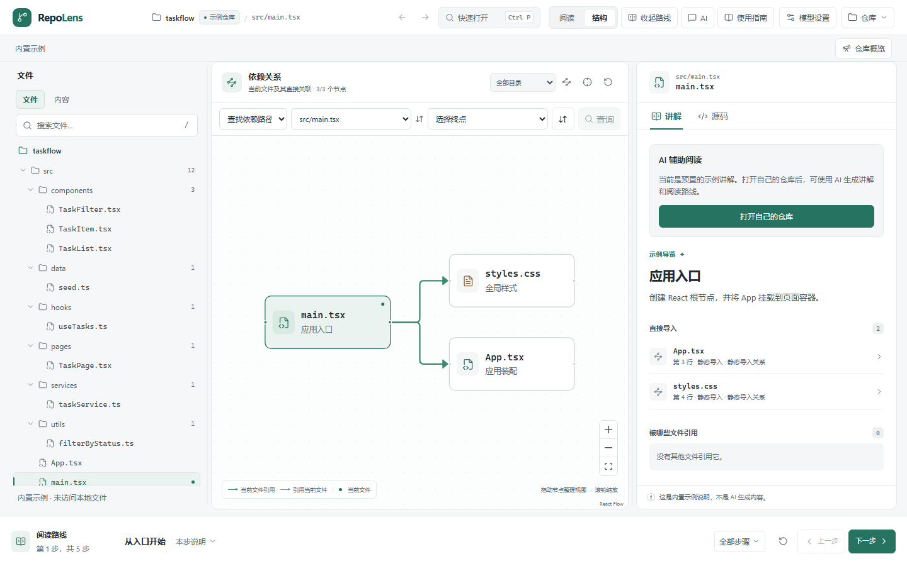

# RepoLens

[简体中文](./README.md)

RepoLens is a local-first tool for reading unfamiliar JavaScript, TypeScript, Python, and Go repositories. Search code and follow static dependencies, then save what you learn as a reading route or an investigation. When you use an AI model, review the context before sending and follow citations back to the source.



## Run from source

You need Node.js 22.13 or later. Opening a GitHub repository or comparing revisions also requires Git.

```sh
npm ci
npm run dev
```

Open [127.0.0.1:5173](http://127.0.0.1:5173) and choose the built-in sample to explore the workspace.

- **Desktop preview** · `npm run preview:desktop` opens Electron directly from source.
- **Windows downloads** · See [GitHub Releases](https://github.com/lumeng-Agt/RepoLens/releases) for available installers, portable builds, and checksums.
- **Windows PowerShell** · Use `npm.cmd` if your execution policy blocks `npm.ps1`.

## Documentation

- [User and developer guide (Chinese)](./docs/guide.md)
- [Chat and source navigation (Chinese)](./docs/chat-usage.md)
- [Code investigations and retrieval evaluation (Chinese)](./docs/investigation-workflow.md)
- [Third-party notices](./THIRD-PARTY-NOTICES.md)
