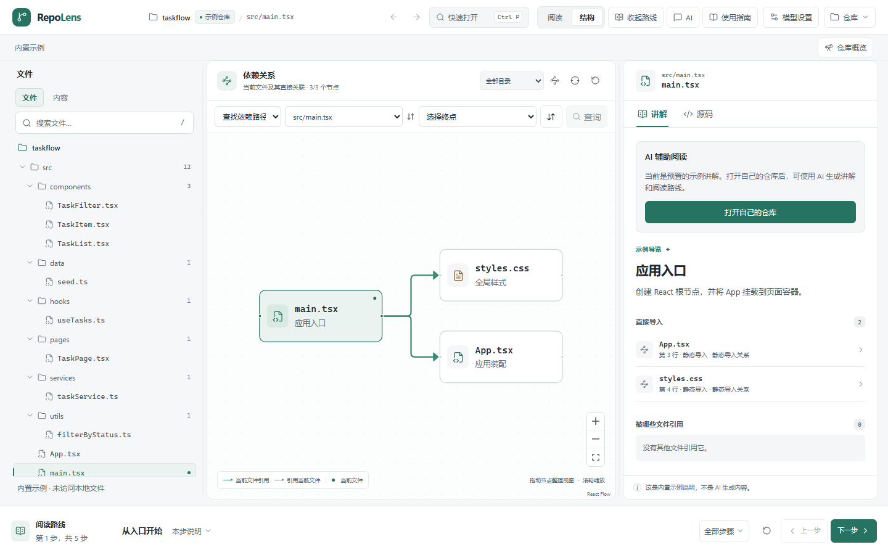

# RepoLens

[English](./README.en.md)

RepoLens 是一个本地优先的代码阅读工具。打开陌生仓库后，可以搜索源码、沿静态依赖浏览文件，并用阅读路线或调查记录留住线索。需要模型协助时，先查看发送范围，再从回答回到源码核对。



## 运行

从源码运行需要 Node.js 22.13 或更高版本。打开 GitHub 仓库或比较版本需要本机 Git。

```sh
npm ci
npm run dev
```

浏览器打开 [127.0.0.1:5173](http://127.0.0.1:5173)。点击「查看示例」可直接体验 JavaScript／TypeScript、Python 和 Go 仓库通用的阅读流程。

- **预览桌面界面** · `npm run preview:desktop` 直接从源码启动 Electron。
- **获取 Windows 发行版** · 在 [GitHub Releases](https://github.com/lumeng-Agt/RepoLens/releases) 查看可用的安装版、便携版和校验值。
- **Windows PowerShell** · 如果执行策略拦截 `npm.ps1`，将上述命令中的 `npm` 换成 `npm.cmd`。

## 文档

- [使用与开发指南](./docs/guide.md)
- [聊天与源码联动](./docs/chat-usage.md)
- [代码调查与检索评测](./docs/investigation-workflow.md)
- [第三方组件与许可证](./THIRD-PARTY-NOTICES.md)
