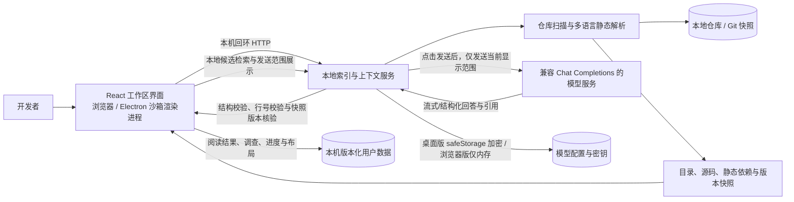
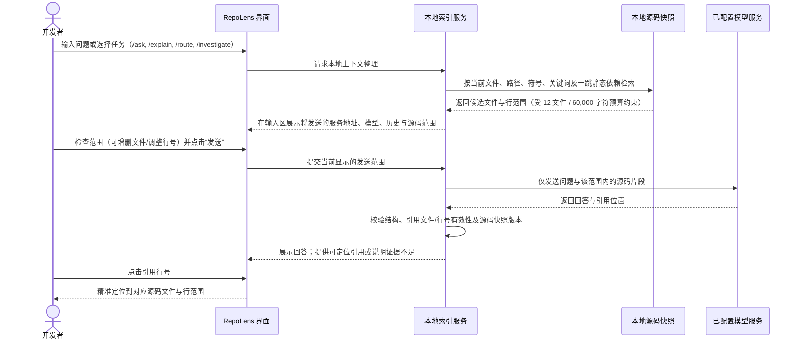

# RepoLens 使用与开发指南

## 系统架构与数据流

浏览器版与 Windows 桌面版共用 Vite 构建的 React 单页应用和 Node.js 本地服务。桌面版由 Electron 在本机回环地址（`127.0.0.1` 随机端口）启动界面与服务，渲染进程启用沙箱（Sandbox）和上下文隔离（Context Isolation），页面无法直接访问 Node.js API。



### AI 问答与引用核验数据流



---

## 快速开始

### 方式一：Windows 桌面版（开箱即用）

桌面版适用于 **Windows x64**，内置运行环境，**不要求本机安装 Node.js、Python 或 Go**。

1. **获取发行包**：在 `release/` 目录（也可查看 [GitHub Releases](https://github.com/lumeng-Agt/RepoLens/releases)）中获取：
   - **安装程序**：`RepoLens-{version}-x64-Setup.exe`（支持选择安装目录，自动创建开始菜单与桌面快捷方式）
   - **便携版**：`RepoLens-{version}-x64-Portable.exe`（解压或直接运行，无需安装）
2. **首次启动提示**：首版不包含自动更新；未配置代码签名证书时，发行物会明确标记为未签名，Windows SmartScreen 可能显示来源提示。
3. **GitHub 仓库支持**：打开远程 GitHub 链接依赖本机已安装的 `Git for Windows` 及系统配置的 Git 凭据（如 GitHub Credential Manager）。RepoLens **不单独接收或存储 GitHub Token**。

### 方式二：浏览器开发版（源码运行）

本地开发要求 **Node.js `>= 22.13.0`**：

```bash
# 1. 安装依赖
npm ci

# 2. 启动浏览器界面与本地回环索引服务
npm run dev
```

启动后访问 `http://127.0.0.1:5173`。

- **仅体验内置示例**：运行 `npm run dev:ui`（仅加载内置 `TaskFlow` 示例，不启动真实仓库索引服务）。
- **预览最新桌面端界面**：运行 `npm run preview:desktop`（编译桌面端前端并直接启动 Electron，不生成安装包，也不替换 `release/` 目录）。

---

## 核心工作流与使用指南

### 1. 打开仓库与快速导航

- **欢迎页与内置教学**：首次启动显示首页，可从最近打开的仓库继续、打开新仓库，或体验内置 `TaskFlow` 示例的五步导览。顶部 **“使用指南”** 可随时重新打开操作清单（仅教学软件操作，与仓库自身的阅读路线分开记录；欢迎与示例教学不调用模型、不访问 GitHub）。
- **支持的仓库输入**：
  - **本地目录**：输入本地文件夹路径或通过桌面版文件夹选择器打开。
  - **GitHub URL**：支持仓库主页 `https://github.com/{owner}/{repo}` 及子树链接 `https://github.com/{owner}/{repo}/tree/{branch、tag 或 commit}/{subdirectory}`（分支名可含斜线 `/`）。子树链接仅改变打开后的初始目录定位，索引仍覆盖该提交下符合限制的整个仓库。不支持单文件 `/blob/`、SSH URL、非 HTTPS 链接或企业自建 GitHub 主机。
- **高效导航与布局切换**：
  - `Ctrl+P`（macOS 为 `⌘P`）：按文件路径或已解析符号快速打开文件。
  - `Alt+←` / `Alt+→`：在浏览过的源码位置之间后退、前进。
  - **阅读 / 结构布局切换**：顶部一键切换。“阅读布局”折叠概览以最大化源码视野；“结构布局”并列展示静态依赖图谱与源码详情。
  - **大文件渲染优化**：大文件按可见行窗口渲染并保留完整无障碍文本；小文件复用语法高亮结果。

### 2. 静态分析、依赖图谱与内容搜索

- **仓库概览**：展示 README 摘要、项目配置依据（`package.json`、`pyproject.toml`、`go.mod` 等）、目录分布、测试位置与入口文件候选。
- **静态分析详情**：提供当前文件的符号大纲、定义行范围与每条依赖边的解析依据。
- **依赖图查询**：支持查询两文件间的**有向最短路径**、当前文件的**潜在影响范围**及**循环依赖**，也可点击 **“在聊天中分析”** 将静态关系直接带入 AI 会话。
- **全文内容搜索**：支持区分大小写、全词匹配、正则表达式、按目录／语言筛选及一键排除测试文件。结果按路径与行号排序，支持分页与多选直接加入 AI 问答候选上下文；切换仓库快照后旧行号自动停用并重新查询。

### 3. AI 辅助阅读：问答、文件讲解与阅读路线

在工作区顶部打开 **AI 侧栏**（支持拖动边缘或使用方向键调整宽度，双击恢复默认宽度），即可在同一会话中完成多种阅读辅助任务：

#### 模型配置
- 支持 **OpenAI 兼容接口（Chat Completions）、DeepSeek、Ollama 和 LM Studio** 预设。
- 提供两个独立的连通性检查操作：**“获取模型列表”** 与 **“发送固定文字测试模型”**（测试操作绝不发送任何仓库信息）。
- 本机回环地址（如本地 Ollama / LM Studio）支持免密模式；若接口地址返回 HTTP 重定向，RepoLens 会主动中止请求以防密钥泄露，请填写最终接口地址。Anthropic 原生协议需另行适配。

#### 聊天交互与快捷指令
- **上下文模式**：默认启用 **“自动参考仓库”**（根据问题按文件名、路径、符号、关键词及一跳静态依赖在本地自动检索相关片段，无需预先手动选文件）；也可切换为 **“仅对话”**（不附带源码）。若仓库中无可索引源码，仍可直接聊天；未找到明确源码范围时，回答会严格区分通用建议与尚未确认的仓库事实。
- **快捷输入**：
  - 输入 `@`：搜索并引用已索引的文件、目录或符号（选择符号自动附上定义行范围；目录超过 12 个文件时提示逐个选择）。
  - 输入 `/`：快速切换任务模式——`/ask`（自由问答）、`/explain`（讲解当前文件）、`/route`（生成阅读路线）、`/investigate`（定位改动位置）、`/new`（新建对话）。
  - 源码联动：在源码阅读器中点击行号再 `Shift+点击` 结束行（或直接拖选代码），可一键触发 **“加入聊天”**、**“解释这段代码”** 或 **“添加笔记”**。
  - 发送键：`Enter` 发送，`Shift+Enter` 换行（中文输入法选字确认不会误触发发送）。
- **发送范围透明与预算控制**：
  - 发送前输入区会先在本地完成上下文整理，可展开查看本次将发送的**服务地址、模型、文件列表、行范围、入选原因、粗略 Token 估算与历史消息**。
  - 聊天侧栏点击 **“发送”** 即发送当前显示的范围，不再弹出二次确认；详情页中保留的独立生成入口仍采用“先预览、再确认”。
  - 每次请求最多携带 **最近 6 条有效历史消息、12 个源码文件、总计 60,000 字符**；手动添加超预算时需先调整范围，绝不静默截断。
  - **“让 AI 帮忙找文件”**：先向模型发送目录与符号摘要以获取推荐文件列表；将推荐文件加入附件后，需再次点击发送才会用于生成最终回答，不会在后台自动连续调用模型。
- **流式输出与校验**：普通问答支持真实流式输出（中断或断流后保留未完成文字供参考，但不会作为已完成答案保存或带入后续历史）；文件讲解（必须引用当前文件）与阅读路线（第一步必须从当前文件开始）在完成结构与行号校验后展示结果卡片。

### 4. 围绕需求调查代码与编辑器衔接

1. **发起改动调查**：在 AI 侧栏任务菜单选择 **“定位改动位置”**（或输入 `/investigate`），描述需求（如 *“给任务取消增加超时，需要检查哪些位置？”*）。
2. **多维依据区分**：模型结合本地检索返回候选修改位置、源码依据与待确认问题，界面明确区分 **关键词检索命中、静态导入关系与模型推断**（候选位置不代表确定需要修改，静态依赖不代表运行时调用）。依据不足时可在范围面板直接执行本地补充搜索，不消耗模型请求。
3. **保存与持续追踪**：点击 **“保存调查”** 后，可在工作区 **“调查记录”** 中继续编辑、重命名、排除无关文件或勾选 **“人工已核对”**，也可通过 **“调整这份结果”** 基于已有调查继续迭代（自动检查并发修改并重置核对标记）。源码更新后，受影响的调查证据会自动标记为“需复核”。
4. **衔接 VS Code 与交接导出**：
   - **在 VS Code 中打开**：Windows 桌面版打开本地仓库时，可从源码标题栏或调查候选位置一键选择 **“在 VS Code 中打开”**（自动探测常见安装路径或手动指定一次 `Code.exe`；跳转前核验会话、文件哈希与行号，仅打开文件而不执行任何任务）。
   - **导出与导入**：支持将调查记录复制为摘要文本，或导出为 **Markdown 交接稿**与**版本化 JSON**（默认不附带独立源码全文副本）。JSON 导入时自动校验跨仓库／跨 ref 差异与引用有效性，冲突记录保留为副本。

### 5. 阅读记录、手动路线与版本比较

- **阅读记录与手动路线**：支持为任意文件与行范围添加**笔记、书签和待理解问题**，并可从有效记录直接组装**手动阅读路线**（自定义标题、目标、步骤顺序、阅读目的与引用行，保存前自动重读源码核验行号）。支持导出 Markdown 分享说明或版本化 JSON 备份。
- **只读版本比较**：
  - 支持对比 **当前工作区相对 `HEAD`** 或 **本地已有两个提交（Commit）之间** 的差异。
  - 打开 GitHub 仓库缺少目标对比版本时，可点击 **“获取所需版本”**，核对仓库地址与完整分支／标签／提交 SHA 后按需拉取比较对象（不切换当前阅读快照，也不后台自动轮询）。
  - 新增、修改、删除、重命名文件及有限大小的新增未跟踪文本文件均以只读 Diff 展示：
    - `<= 1 MiB`：展示逐行差异预览。
    - `1 MiB – 64 MiB`（工作区文件）：通过流式哈希判定是否变化，变化时单独列出，不生成逐行 Diff。
    - `> 64 MiB`：明确标记为未比较。
  - **变更阅读“建议检查”**：根据变更文件的静态依赖及测试文件命名规则自动整理待检查候选，支持一键加入“调查记录”逐项核对。

---

## 语言解析能力与系统边界

### 多语言静态解析

| 语言 | 解析引擎 | 支持特性 | 明确边界 |
| :--- | :--- | :--- | :--- |
| **JavaScript / TypeScript** | TypeScript Compiler API | 静态 `import`、再导出（`export ... from`）、字面量 `require()`、动态 `import()`、`tsconfig` / `jsconfig` 路径别名与配置继承链 | 配置继承仅读取当前打开范围内的普通文件（含本范围内的依赖预设），但 `node_modules` 等依赖源码本身不纳入索引 |
| **Python** | Tree-sitter WASM（随应用内置分发） | `.py` 与 `.pyi`、普通 `import`、`from ... import`、相对导入、根目录与 `src/` 布局解析 | 动态模块导入、标准库与未解析第三方模块作为状态或诊断显示；绝不执行 `setup.py` 或项目配置代码 |
| **Go** | Tree-sitter WASM + 模块清单解析 | 分组导入、别名导入、空白导入（`_`），解析 `go.mod`、`go.work` 及仓库内本地 `replace` | 标准库、外部模块与本地包分开标记；包级导入展开为包内文件时明确标注为“包级关系”，不臆测具体符号来自哪个文件；条件编译文件可阅读但不按宿主机平台过滤 |

### 索引限制与安全边界

- **文件数量与体积上限**：单次最多索引 **5,000 个源码文件**，单个源码文件不超过 **1 MiB**。超出限制时明确拒绝并给出提示，**绝不静默截断**。
- **忽略规则与硬性排除**：遵循仓库 `.gitignore` 与 `.repolensignore`（若某目录忽略规则读取失败则停止扫描该目录，防止扩大读取范围）。系统硬性排除且始终禁止读取：`.git`、`.env*`、依赖目录（如 `node_modules`）、构建产物、虚拟环境、缓存目录、二进制文件与**符号链接（Symlinks）**。
- **路径越界与防替换校验（TOCTOU 防护）**：源码、配置文件、忽略规则、README 与版本比较共用严格的路径边界与文件身份（File Identity）核验；任何越界访问、符号链接或读取期间被替换的文件均会被立即拒绝，且诊断信息绝不泄露仓库外的宿主机绝对路径。

### 本地持久化与隐私安全

- **数据存储位置**：
  - **打包后的 Windows 桌面版**：使用 Electron 用户数据目录（`%APPDATA%\RepoLens`）。
  - **独立本地服务（`npm run dev` / `npm start`）**：默认使用 `%LOCALAPPDATA%\RepoLens`（macOS/Linux 为 `~/.local/share/repolens`）。
  - 两种运行方式的数据默认互不共享；可通过设置环境变量 `REPOLENS_USER_DATA_PATH` 显式指定目录。
- **保存内容与原子恢复**：本地保存最近 20 个成功打开的仓库记录、讲解、路线、问答、调查、阅读进度和依赖图节点坐标。采用版本化文件与原子写入，损坏记录自动隔离恢复；读取失败时绝不以空默认值覆盖磁盘已有数据。**原始源码全文快照与模型请求中的独立源码副本不会落盘保存**（生成的摘要或笔记文字本身可能包含代码摘录）。
- **密钥加密存储**：
  - **Windows 桌面版**：通过操作系统级 `Electron safeStorage` 加密保存模型配置与 API 密钥，下次启动自动恢复且密钥不会回传给前端页面；若系统加密不可用，**绝不降级为明文保存**（该次设置不生效并明确提示失败）。
  - **浏览器开发版**：API 密钥仅保留在当前本地服务进程内存中，随进程退出清空。
- **数据清理**：支持在侧栏或设置中移除单条最近仓库记录、清除当前仓库保存内容，或一键 **“清除全部数据”**（同时移除加密保存的模型配置与密钥）。关闭桌面应用时会自动取消进行中的 Git 操作、等待索引服务安全退出并清理远端仓库临时目录。

---

## 项目结构

```text
repo-lens/
├── app/                  # React 工作区界面、样式系统 (workspace.css / globals.css) 与视图组织
├── hooks/                # 仓库会话、布局、聊天入口、指南与持久化协调
├── components/           # 基础 UI 组件
├── data/                 # 核心领域逻辑：多语言静态解析、本地索引、检索、AI 上下文门控、持久化与版本比较 (*.mjs + *.test.mjs)
├── desktop/              # Electron 主进程 (main.mjs)、预加载脚本 (preload.cjs)、安全策略与模型加密存储
├── scripts/              # 本地回环服务与按功能拆分的 server 路由、自动化验收 (verify.mjs)、桌面打包与来源校验、性能基准与评测脚本
├── e2e/                  # Playwright 端到端回归测试套件
├── fixtures/             # 演示示例仓库 (ai-integration-sample) 与离线检索评测基准数据集
├── docs/                 # 公开使用说明与检索评测
└── release/              # 经完整烟测验证的干净工作区 Windows 正式发行物与 SHA-256 校验清单
```

---

## 开发、验证与打包

RepoLens 配备了从单元测试、静态检索质量门槛、端到端浏览器联调到桌面安装包真实烟测的完整自动化验证链。

> **首次运行测试提示**：`npm test` 与 `npm run test:e2e` 包含由 Playwright 驱动的浏览器联动检查。全新环境首次运行前请先执行：
> ```bash
> npx playwright install chromium
> ```

### 常用验证与构建命令

| 命令 | 说明 |
| :--- | :--- |
| `npm run verify` | **全量源码验收**：按顺序执行类型检查、ESLint、Node 单元回归、Web/Desktop 双前端构建、浏览器与本地服务联动及开发/生产启动矩阵（默认不打桌面安装包；日志保存在 `.artifacts/verify/`） |
| `npm run verify -- --package-desktop` | 在全量源码验收基础上，额外构建桌面候选包并运行桌面端烟测（使用 `--list` 可仅查看步骤） |
| `npm test` | 运行 `data/`、`scripts/` 与 `desktop/` 下的所有单元与服务集成测试 |
| `npm run test:e2e` | 运行 Playwright 浏览器回归测试及基于本地 bare Git 仓库与本地模拟模型的全链路集成测试 |
| `npx tsc --noEmit` | 运行 TypeScript 类型检查 |
| `npm run lint` | 运行 ESLint 代码规范检查 |
| `npm run build` | 构建 Web 端生产产物 |
| `npm run build:desktop` | 构建 Electron 桌面端渲染进程产物 |
| `npm run package:desktop` | **构建并验证 Windows 桌面发行包**（生成安装版 `Setup.exe` 与便携版 `Portable.exe`） |
| `npm run test:desktop:smoke` | 针对打包后的桌面可执行文件运行隔离数据目录全流程烟测（支持通过 `REPOLENS_DESKTOP_EXECUTABLE` 指定便携版路径） |
| `npm run check:startup` | 检查开发版与生产版首次启动、导航与刷新的稳定性 |
| `npm run benchmark:indexer` | 运行索引器性能基准（测量 5,000 文件冷扫描、单文件增量更新与配置变更耗时） |
| `npm run smoke:github` | 运行公开 GitHub 仓库在线拉取与索引烟测（需联网访问 GitHub，不调用 AI 模型） |
| `node scripts/check-retrieval-quality.mjs` | 运行代码调查离线检索评测集与质量门槛检查（不调用模型，不执行样例代码） |

### 本地预览与清理

`npm run build` 后可运行 `npm start`，在本机预览生产前端与索引服务。日常查看桌面最新源码用 `npm run preview:desktop`，这会直接启动 Electron。

- `npm run clean` 列出可清理的默认生成目录及估算体积。
- `npm run clean -- --artifacts --release` 将本地过程产物和发行物也列入预览。
- 确认范围后加 `--apply` 才会删除所列目录。请先退出正在使用相应文件的程序。

### 桌面打包与发行

运行 `npm run package:desktop` 时，构建脚本遵循严格的交付门控：
1. 先在 `.artifacts/desktop-candidates/` 下生成候选包、写入 `BUILD-MANIFEST.json`（记录应用版本、Git Commit、工作区干净状态、参与构建文件 SHA-256、Node/Electron 版本与构建时间）及校验值清单。
2. 自动启动候选包执行 `test:desktop:smoke` 真实界面烟测（覆盖模拟模型配置、讲解／路线／多轮问答、确认前零调用门控、引用定位、Python/Go 索引、跨重启恢复、源码变化过期保护、损坏存储隔离恢复与安全退出）。
3. **仅当烟测全部通过且 Git 工作区干净（无未提交改动）时**，才会将正式包同步替换至唯一交付目录 `release/`；若工作区包含未提交修改，构建产物仅保留在 `.artifacts/desktop-candidates/` 供开发调试，绝不污染正式发行物。

---

仓库的 **Draft Windows Release** 工作流可按明确指定的版本标签构建并验包，将安装版、便携版和校验清单上传为草稿。发布前可在 GitHub 核对草稿和附件。

## 延伸文档与许可证

- **AI 聊天与源码联动说明**：[docs/chat-usage.md](./chat-usage.md)
- **代码调查与离线检索评测**：[docs/investigation-workflow.md](./investigation-workflow.md)
- **第三方组件与开源许可证清单**：[THIRD-PARTY-NOTICES.md](../THIRD-PARTY-NOTICES.md)
