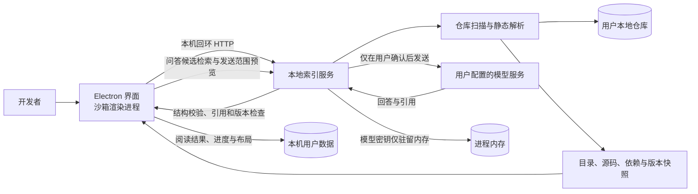
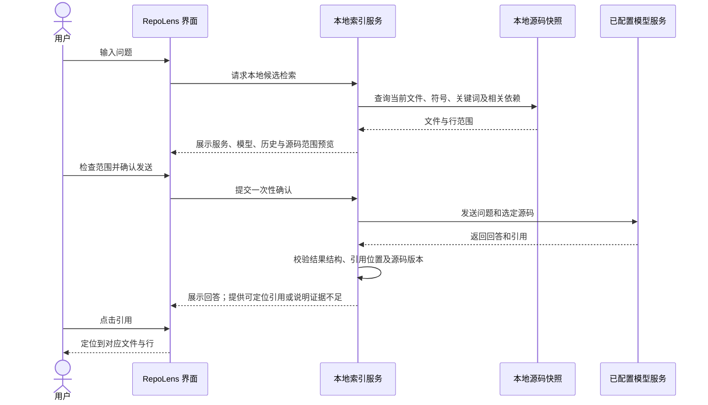

# RepoLens 项目介绍

## 项目概述

RepoLens 帮助开发者快速理解陌生的 JavaScript/TypeScript、Python 和 Go 代码库。用户可以在一个本地工作区查看目录、静态依赖图、源码和阅读路线，也可以选择一段源码上下文，请模型提供带引用的只读解释或回答。

核心工程问题是如何把模型能力接入代码阅读流程，同时让用户知道哪些源码会发给模型，并能回到回答所依据的文件和行号。RepoLens 通过本地静态分析和检索准备上下文，由用户预览并确认后才调用兼容 Chat Completions 的模型服务。

## 架构

浏览器开发版复用界面与本地服务；Windows 桌面版由 Electron 启动两者，并将服务限定在本机回环地址。桌面渲染进程启用沙箱和上下文隔离，应用不运行被分析仓库中的命令，也不修改仓库。

## 问答数据流

## 关键设计取舍

- **静态依赖优先。** TypeScript 使用 TypeScript Compiler API，Python 和 Go 使用随应用分发的 Tree-sitter WASM 语法文件。无需安装或执行被分析项目依赖，也避免仓库配置代码在扫描时运行。
- **本地检索组织上下文。** 问答按当前文件、名称、路径、符号、关键词及直接依赖筛选源码；不依赖远程向量数据库。请求范围受文件数和字符数限制，超限时由用户缩小范围。
- **发送前可检查。** 每次模型请求都先显示服务、模型、历史和源码范围；用户逐次确认。确认失效或源码上下文改变后，需要重新预览。
- **引用可核验。** 生成结果按当前仓库快照校验引用文件和行号；源码改变后，旧回答和路线的引用跳转会失效。
- **桌面数据本地保存。** 阅读结果和进度保存在 Electron 用户数据目录；模型密钥只在本地服务内存中，关闭应用后清空。原始源码快照不保存到工作区记录中。

## 当前边界

依赖图表达静态源码引用，不表示运行时调用。引用指向有效文件和行号，只能证明位置存在，不能单独证明模型解释正确。模型回答质量仍需要按具体模型和任务评估。GitHub 访问通过本机 Git 和已配置的系统凭据完成；首版 Windows 桌面应用没有自动更新。完整支持范围和限制见 [README](../README.md)。
